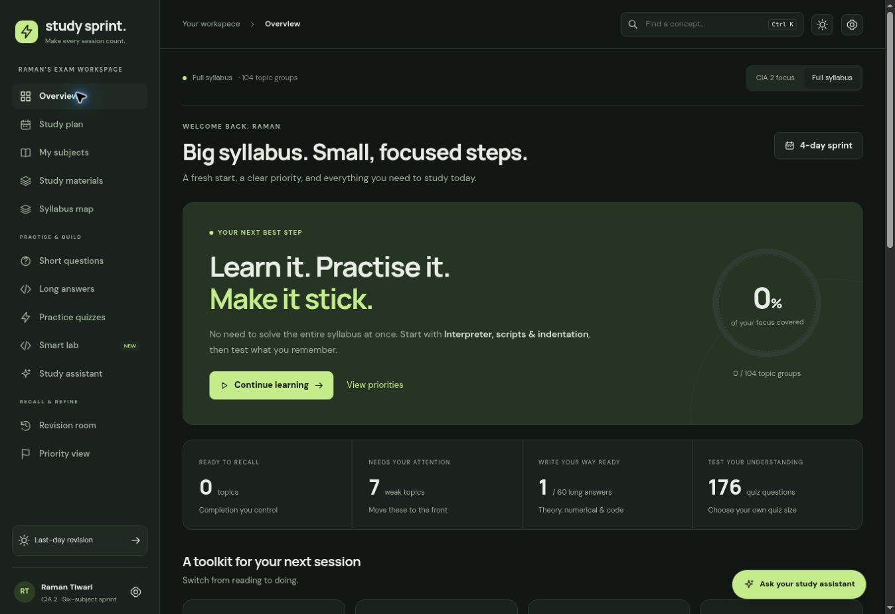

# Study Sprint

A focused exam-preparation workspace for Raman Kumar Tiwari: six subjects, a flexible study plan, worked questions, quizzes, revision tracking, a coding lab and a syllabus assistant.

[Live study dashboard](https://raman-cia2-study-sprint.fondhyssop1.chatgpt.site/)



## Run locally

Use **Node.js 22 or newer**. The application, build and tests use native JavaScript modules and Node built-ins; there are no npm package dependencies to install.

```bash
git clone https://github.com/tiwariraman884/studySprint.git
cd studySprint
npm run dev
```

Open **http://127.0.0.1:3000**. Keep the terminal running. Edit a frontend file and refresh the browser; restart the server after changing backend code. Do not open `index.html` directly: module loading and the compiler API need an HTTP server.

```bash
npm test          # Content, search, compiler and architecture checks
npm run check    # Check JavaScript syntax
npm run build    # Create dist/client and dist/server
npm run verify   # All checks, tests and the production build
```

For a different port: `npm run dev -- --port 4000`. Bind another interface explicitly with `--host` when needed.

## Features

- **Six subjects:** Digital Electronics; Object Oriented Programming (C++); Discrete Structure; Data Structures & Algorithms; Universal Human Values; Python Programming Lab (CSP-005).
- **36 chapters/exercises:** 25 theory units and 11 Python exercise groups, with 104 topic guides, simple explanations and optional Hinglish support.
- **Practice:** 140 short questions, 60 long answers and 176 MCQs. Filter by subject, chapter, question source and theory/numerical/programming format.
- **Planning:** 1–60 days, daily study hours, subject selection, honest workload/backlog and separate session completion and topic mastery.
- **Revision:** completed/weak topic tracking, missed-quiz review, priority ordering, focus timer and last-day recall.
- **Smart lab:** Python, C++17 and JavaScript; stdin, actual output/errors, Stop, autosaved drafts and debugging hints.
- **Assistant:** syllabus retrieval with subject choices, typo-tolerant matching and follow-ups such as “explore it” or “give an example”. Optional local AI remains experimental.
- **Interface:** dark/light themes, responsive navigation and portable progress backups.

## Repository layout

| Path | Responsibility |
| --- | --- |
| `src/client/app/` | Application composition, state initialization and event delegation |
| `src/client/features/` | Dashboard, planner, subjects, materials, questions, quiz, revision, lab, assistant, settings and focus timer |
| `src/client/ui/` | Shared icons and study diagrams |
| `src/client/styles/` | Base styles and responsive theme/layout rules |
| `src/content/subjects/` | Subject metadata, syllabuses, topic guides and resource links |
| `src/content/` | Question banks, lab examples, algorithm traces and catalog assembly |
| `src/server/` | HTTP Worker and the bounded C++ compiler API |
| `public/` | HTML entry point and independent AI worker |
| `scripts/` | Portable development server, asset collection, checks and build |
| `tests/` | Node test-runner suites |
| `docs/` | Architecture, deployment, content editing and verification notes |
| `.github/workflows/` | CI checks on pushes and pull requests |

The frontend uses explicit ES-module imports and a shared application context passed to feature registrars. There are no global script-order overrides. The previous duplicate page renderers have been consolidated into one active implementation per feature. See [Architecture](docs/ARCHITECTURE.md).

## Runtime requirements and limits

**Python and JavaScript** run in disposable workers inside an opaque-origin sandboxed iframe. Python downloads Pyodide on first use; NumPy and pandas can load on demand. Files reset after each run. Flask servers, unsupported native packages and some network operations need a local Python installation.

**C++17** uses Compiler Explorer's GCC 13.2 service. Pressing Run sends the editor text and stdin to that service through `/api/compile`. Availability and service limits apply. User programs never execute inside the application server.

**Optional AI** downloads approximately 700 MB for Qwen2.5 Coder 0.5B and its runtime. It runs on the device, needs no API key and can be slow or wrong, including when debugging. It is not a reliable general-purpose tutor. Syllabus retrieval and instant error hints work without this download.

Progress, theme, notes, chat, quizzes, code and plans are saved in the current browser. There is no account database or automatic cross-device sync. Use **Backup & preferences → Export progress** before moving browsers or hosts. The original storage key and backup format remain compatible; different website origins have separate browser storage.

## Deployment and ownership

`npm run build` produces a static frontend and a Cloudflare-compatible Worker. `wrangler.jsonc` is included for a deployment you configure. Static-only hosting will not provide C++ execution without the matching API. Read [Deployment](docs/DEPLOYMENT.md).

The existing live Sites publication and this GitHub repository are separate source destinations. Pushing to this repository runs checks; it does **not** automatically replace the live site. No hosting credentials or private source PDFs are included.

The questions marked as uploaded-paper questions come from the supplied papers. Additional chapter questions are authored practice, not predictions. CIA 2 focus is an inferred preparation filter, not a confirmed exam boundary. See [Content guide](docs/CONTENT.md) and [Verification](docs/VERIFICATION.md).

No open-source license has been selected for this repository. Third-party runtimes and learning resources retain their own licenses and terms.
