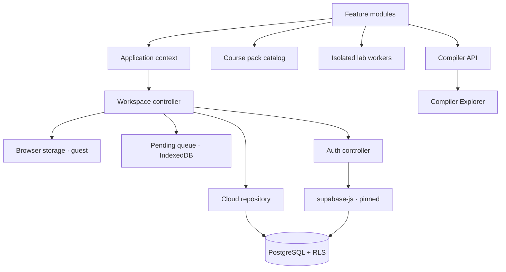

# Architecture

Dependency-free JavaScript in the browser, a small HTTP Worker on the server, and
PostgreSQL (Supabase) for shared content and per-student records.

## Layers

| Layer | Depends on | Must not |
| --- | --- | --- |
| Content modules | Other content modules | Touch the DOM or storage |
| Pack contract / catalog | Content modules | Know about a user |
| Core (`src/client/core`) | Pure helpers and injected boundaries | Touch the DOM |
| Feature UI | Application context | Read server secrets or call the SDK directly |
| Workspace controller | Auth, stores, features | Invent a second source of truth |
| Auth controller | supabase-js only | Render anything |
| Server | Worker APIs | Send a service key to a page |
| Build | Source files | Emit a bundle containing a secret |

## Composition

`src/client/index.js` calls `createApplication()`:

1. Content modules are imported and every feature registers its methods on one
   application context (`app`).
2. `initializeState` loads saved guest state and fills defaults.
3. Events are delegated from `app/events.js`.
4. The first `render()` runs, so studying works immediately.
5. `createWorkspace(app)` installs persistence, applies the pack and subject
   selection, starts the auth lifecycle and offers first-visit onboarding.

The workspace controller is what makes the old feature API keep working: features
still call `app.save()` and `app.render()`, and the controller decides whether
that means browser storage or a queued cloud write. Subject selection rebuilds
`app.SUBJECTS`, `app.TOPICS`, `app.LONG`, `app.CURRICULUM`, `app.QUIZ_BANK` and
the exam-focus map, so every page filters consistently without a per-page
rewrite.

## Boundaries that are tested

- No module in `src/client`, `src/content` or `public` may mention a service-role
  key, a database URL with a password, or `postgres://`.
- The build fails if any of those patterns reach an asset.
- The server injects only `supabaseUrl` and `supabaseAnonKey`.
- Every browser-side fingerprint function is compared with its SQL counterpart
  against a real database.

## Lookups and keys

`app.getTopic` and `app.getSubject` accept both a namespaced key
(`cia-2-2025-26:de:de1`) and a legacy bare id (`de1`), so saved references from
the original dashboard keep resolving. Records are always keyed by the
namespaced value, which is what the database stores and what a new device
resolves through `topic_ids_for_keys`.

## Execution and AI

Unchanged from the original design: `features/lab/frame.js` builds a
self-contained sandboxed worker frame for Python and JavaScript; C++17 goes
through `src/server/api/compiler.js` to a fixed upstream compiler; the optional
assistant loads a quantized model on demand after a pure retrieval pass.

## Build

`scripts/assets.mjs` collects `public/`, `src/client/` and `src/content/`, skips
`config.local.js`, and refuses nothing silently. `scripts/build.mjs` writes
`dist/client`, copies `dist/server`, embeds the asset catalog and scans the
output for secrets before finishing.
