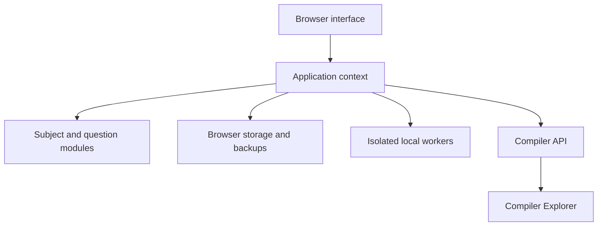

# Architecture

Study Sprint is a dependency-free JavaScript application with a small HTTP backend. It keeps academic content separate from interaction logic and separates code execution from the dashboard.

## Application composition

`src/client/index.js` starts `createApplication()` from `app/create-application.js`. The composition root imports the content catalog and shared UI utilities, registers each feature's methods on one application context, initializes saved state, attaches event listeners and renders the first screen.

Feature modules expose `register(app)`. Each method accesses dependencies explicitly through `app`, such as `app.TOPICS`, `app.s`, `app.save()` and `app.render()`. This preserves coordinated progress updates while preventing window-global declarations and duplicate function overrides. Register all methods before initialization because a saved plan may need the planner during startup.

The application currently assumes one mounted instance per page. `app/events.js` is the central DOM event-delegation layer. UI templates use the shared escaping helper for entered text. Modules return HTML for the existing dialog/navigation structure; this is not a React application and needs no framework build step.

## Boundaries

| Layer | Depends on | Must not do |
| --- | --- | --- |
| Content modules | Other content modules | Access the DOM or browser storage |
| Assistant search | Supplied catalog, history and progress context | Invent answers or execute user code |
| Feature UI | Application context and browser APIs | Read server secrets |
| State and settings | Browser storage and validated backups | Claim automatic cross-device sync |
| Isolated lab frame | Worker runtime and posted run messages | Read the parent dashboard's storage |
| Compiler API | Bounded request and fixed upstream compiler | Execute programs in the hosting process |
| Build scripts | Source files and Node built-ins | Package credentials, PDFs or user backups |

## Content catalog

Each module in `src/content/subjects/` contains a subject, its syllabus units, topic guides and primary reading links. `src/content/index.js` combines these with chapter questions, long answers, lab templates and quiz definitions. Short-question and quiz views derive from this catalog. Topic IDs remain stable because progress and question references depend on them.

## State and backups

State lives in `app.s` and persists under `raman-cia2-sprint-v1`. View filters, running workers and editor UI status remain transient context fields. The settings feature validates basic topic progress, custom plans, long-answer drafts and the newer assistant/lab fields in stages. Unknown references are filtered from imported chat context.

## Execution and AI

`features/lab/frame.js` contains a self-contained frame entry function. Its source is embedded in a sandboxed iframe. That frame launches a fresh worker for each Python or JavaScript run, forwards bounded output and terminates it on Stop. The main dashboard verifies the source window and message channel.

`public/workers/ai-worker.js` loads Transformers.js and a quantized model on demand. It streams optional AI answers. The pure `features/assistant/search.js` module handles syllabus matching, follow-up context and authored responses before AI is considered. Its behavior is tested without loading model weights.

`src/server/api/compiler.js` validates same-origin JSON requests and code/stdin limits, calls only the configured Compiler Explorer endpoint and normalizes compilation/runtime results. Its in-memory rate limiter is per isolate, not a globally enforced quota or a complete anti-abuse system.

## Build and serving

`scripts/assets.mjs` collects only `public/`, `src/client/` and `src/content/`. `scripts/build.mjs` writes those assets to `dist/client/`, copies backend modules into `dist/server/`, and emits an entry point that embeds the asset catalog. `src/server/app.js` serves assets and routes `/api/*` to the compiler handler. The Node development adapter uses the same handler.

Generated output is ignored by Git. A fresh clone can reproduce it with `npm run build`.
